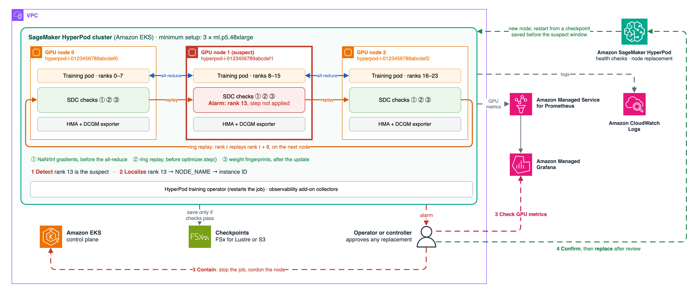
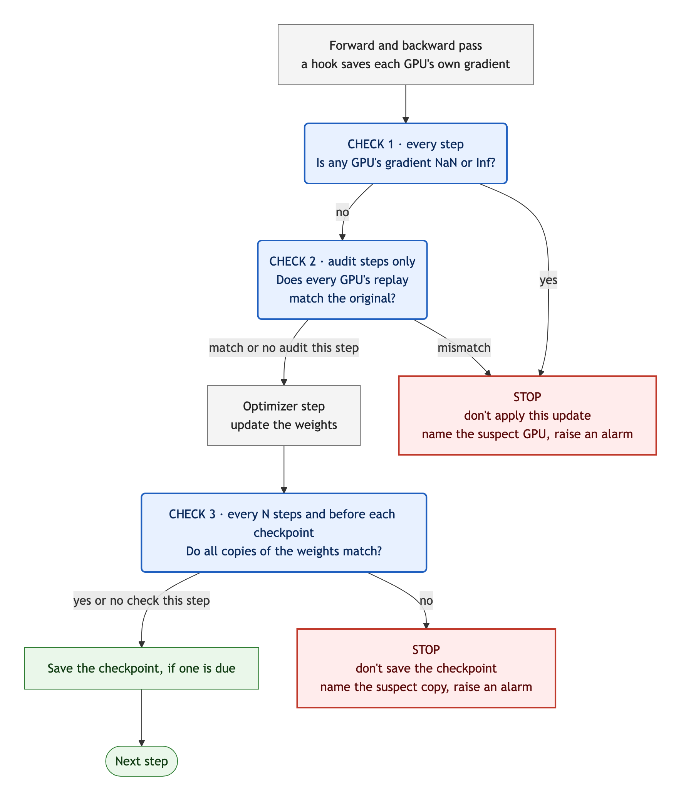

# Detecting silent data corruption in PyTorch DDP training on Amazon SageMaker HyperPod

This use case is the companion code for the AWS Machine Learning Blog post *Detecting and recovering from silent data corruption on Amazon SageMaker HyperPod*.

Silent data corruption (SDC) is a wrong result from a GPU that raises no error. `sdc_order.py` adds three complementary checks to a PyTorch `DistributedDataParallel` (DDP) training loop, in a fixed order within each step. When a check fires, `train()` stops and returns an alarm that names the suspect ranks. The use case also contains the fault-injection experiments we ran on 4 and 3 ml.p5.48xlarge instances of a SageMaker HyperPod cluster orchestrated by Amazon EKS, and their raw results.

> **All data in the experiments is synthetic, and every fault was injected in software.** The results show that each check behaves as designed. They don't show how often real hardware fails.



*The detect, localize, contain, and recover loop from the blog post, on the minimum setup of three nodes. Solid lines are what this use case implements and tests. Dashed lines are the blog post's proposed production workflow, which nothing here runs.*



| Check | Runs | Catches | Misses |
|---|---|---|---|
| **1. NaN/Inf gradient** | Every step, right after backward, before the update | NaN, Inf, or overflow in one GPU's forward or backward pass, on the step it happens | Any wrong value that stays finite |
| **2. Ring replay** | Audit steps, before the update. Every rank recomputes the micro-batch of a rank on another node, and compares the loss bits and, with deterministic kernels, every parameter's gradient fingerprint | Finite wrong values that change the loss or a gradient | Faults on steps without an audit, and faults that change neither |
| **3. Weight fingerprints** | After the update, every N steps and on every checkpoint step | A wrong update or a corrupted stored weight on one copy, named when a strict majority of copies agrees | Wrong updates applied identically to every copy, and sharded weights (ZeRO, FSDP) |

If check 1 or 2 fires, the step that raised it isn't applied; earlier steps since the last passing audit may have been. If check 3 fires, the checkpoint isn't saved.

**Fingerprints** are two 64-bit sums per tensor, of the raw bit patterns and of the bit patterns weighted by position. Any change to one or two elements of a tensor changes them (for tensors with fewer than 2³² elements of up to 4 bytes). Larger changes could, in principle, cancel out, so equal fingerprints are strong evidence of equal tensors, not proof.

## Directory layout

| Path | What it is |
|---|---|
| `sdc_order.py` | The three checks and the training loop that runs them in order. Copy it next to your training script |
| `experiments/run_order.py` | The test driver: fault scenarios, checks of the checks, healthy runs, and timing |
| `experiments/faults.py` | Software fault injection: forward, backward-only, and stored-weight faults |
| `experiments/model.py` | The 953M-parameter Llama-style test model. It also has tensor-parallel, context-parallel, and MoE variants, which `run_order.py` doesn't use |
| `experiments/common.py` | Process groups, configuration, synthetic data, and snapshots |
| `experiments/gen_job.py` | Writes the Kubeflow `PyTorchJob` manifest |
| `experiments/job.sh` | Preflight, push, start, wait, fetch, stop, and clean up |
| `experiments/analyze.py` | Summarizes a run: scenarios, healthy runs, the outlier-test analysis, and schedule estimates |
| `experiments/sanitize.py` | Prepares a fetched run for publishing, with example IDs instead of real ones |
| `results/` | Our two runs, with `RESULTS.md` (tables) and, per run, the raw records, logs, job manifest, and SHA-256 manifest |
| `images/` | The diagrams: the architecture (PNG and draw.io source) and the step flowchart (PNG and Mermaid source) |

## Use the checks in your training loop

Requirements:

- **PyTorch DDP.** Tested with PyTorch 2.9.0 and NCCL 2.27.7. For other parallelism layouts, see [Limitations](#limitations).
- **At least three nodes, numbered node by node.** The ring audit settles an ambiguous comparison with a GPU on a third node, and the weight comparison needs three copies of each weight to name the odd one out. `train()` calls `check_topology()` at start and raises an error unless every replayer, target, and confirming GPU sit on three different nodes. Set `peer_offset` to the GPUs per node.
- **`NODE_NAME` in each pod,** from the downward API (`spec.nodeName`). `check_topology()` uses it to tell nodes apart; without it, it falls back to the hostname, which is wrong when two pods share a node.
- **Rebuildable micro-batches.** `rebuild_batch(step, rank)` must return exactly the micro-batch that rank trained on, so use a seeded sampler, not a stateful iterator.
- **One loss function.** `compute_loss(model, batch)` must be the same function in training and in replay, including autocast. Seed any randomness in it per step and rank, or the replay can't match.
- **Deterministic kernels for audits:** `CUBLAS_WORKSPACE_CONFIG=:4096:8` set before the process starts. On deterministic audit steps, an op without a deterministic implementation raises an error rather than producing a false alarm.

A training script calls it like this. This snippet shows the interface; it wasn't run as written. The test driver, `experiments/run_order.py`, calls `train` the same way.

```python
import sys
import torch
import torch.distributed as dist
import torch.nn.functional as F
import sdc_order as S

stats = S.attach(ddp_model, dp_group)                 # registers the comm hook, once
sched = S.Schedule(audit_every=10, deterministic_audits=True, check_every=10,
                   ckpt_every=100, peer_offset=8)    # 8 = GPUs per node

def compute_loss(model, batch):                      # used for training AND replay
    x, y = batch
    with torch.autocast("cuda", dtype=torch.bfloat16):
        logits = model(x)
    return F.cross_entropy(logits.float().flatten(0, 1), y.flatten())

def rebuild_batch(step, rank):                       # exactly the micro-batch `rank` trained on
    return dataset.micro_batch(step, rank)

def batches(start):                                  # set the LR here; train() doesn't
    for step in range(start, total_steps):
        for g in optimizer.param_groups:
            g["lr"] = lr_schedule(step)
        yield rebuild_batch(step, dist.get_rank())

alarm = S.train(ddp_model, stats, optimizer, batches(start), compute_loss, rebuild_batch,
                save_checkpoint, sched, start_step=start)
if alarm is not None:
    report_sdc(alarm)                                # metric + log line; then map the rank to a node
    sys.exit(3)
```

`train` returns `None` when `batches` runs out, or the first alarm as a dictionary:

| Key | Compute-path alarm (`"check": "compute"`) | Weight alarm (`"check": "weights"`) |
|---|---|---|
| `step` | The step that raised it. It wasn't applied | The step that raised it. Its update was applied; its checkpoint wasn't saved |
| `nonfinite` | Ranks whose local gradient was NaN or Inf | — |
| `mismatched_pairs` | `(target, replayer)` pairs whose replay didn't match | — |
| `culprits` | Ranks in two mismatched pairs | — |
| `verdicts` | For each ambiguous pair: the third GPU, the suspect, and `persistent`, `transient`, `replayer computed wrong`, `unclear`, or `unattributable` | — |
| `suspects` | — | Ranks whose copy differs from a strict majority, or `None` when no strict majority exists |
| `suspect_window` | `[first, last]` steps since the last passing audit | `[first, last]` steps since the last passing weight check |
| `last_audit_pass`, `last_weight_check_pass` | The last step each check passed | The same |

Checkpoints are tagged with `last_audit_pass` and `last_weight_check_pass`. To recover, load the newest checkpoint saved at a step before `suspect_window[0]`. That predates a fault that was active on every step since it began. An intermittent fault can be older, and replica agreement can't show common-mode corruption, so treat the tags as a record that the checks passed at that step, not as proof that the saved state is clean.

On resume, call `S.find_divergent_ranks(params, dp_group)` once after loading a checkpoint and before the first step, to check that every copy loaded the same weights.

To act on an alarm, map the suspect rank to its node: on HyperPod EKS, the Kubernetes node name is `hyperpod-<instance-id>`. The blog post describes the proposed response: cordon the node, check its GPU metrics, run a deep health check when the alarm is ambiguous, and replace the node after review. Nothing in this use case does any of those.

### Choose a schedule

`audit_every` is the main setting:

- **Detection delay:** a persistent finite fault is caught within `audit_every` steps.
- **Corrupted updates:** up to `audit_every − 1` corrupted updates can be applied before the audit catches it. They fall inside the alarm's `suspect_window`.
- **One-time faults:** a finite fault on a single non-audit step that doesn't recur isn't caught at all.

Make `ckpt_every` a multiple of both `audit_every` and `check_every`, so every checkpoint step is audited before its update and fingerprinted after it. Keep `check_on_checkpoint=True`. In our tests, turning it off let a checkpoint be saved from a corrupted copy.

Estimated cost on the 953M test model, 32 H100s, from our measured medians, including a weight check every 10 steps:

| Schedule | Estimated average step time (953M model, 32 H100s) | Over plain DDP |
|---|---|---|
| Deterministic audits every 10 steps | 213.7 ms | +35% |
| Default-kernel audits every 10 steps | 178.4 ms | +13% |
| Deterministic audits every 50 steps | 178.8 ms | +13% |
| Deterministic audits every 100 steps | 174.4 ms | +11% |
| Default-kernel audits every 100 steps | 170.9 ms | +8% |

Default-kernel audits compare the loss only, so they miss faults that occur only in the backward pass. Measure the cost on your own model: deterministic attention uses the math kernel, whose cost grows with the square of the sequence length.

## Reproduce the experiments

Prerequisites:

- A SageMaker HyperPod cluster orchestrated by Amazon EKS, with at least three idle GPU nodes. We used ml.p5.48xlarge. See [`architectures/sagemaker-hyperpod-eks`](../../../architectures/sagemaker-hyperpod-eks) for cluster setup.
- The Kubeflow training operator (`PyTorchJob`), which the HyperPod Helm chart installs, and the EFA and NVIDIA device plugins.
- `kubectl` pointed at the cluster, with permission to create a namespace (or use an existing one), a ConfigMap, a `PyTorchJob`, and `pods/exec`. Python 3 locally.

The job uses the [AWS Deep Learning Containers](https://github.com/aws/deep-learning-containers/blob/master/available_images.md) PyTorch training image for us-east-1, pinned by digest. In other Regions, pass `--image` with your Region's URI. The code reaches the pods through a ConfigMap, so there's no image to build.

```bash
git clone https://github.com/awslabs/awsome-distributed-ai.git
cd awsome-distributed-ai/examples/use-cases/sagemaker-hyperpod-sdc-detection/experiments

export EXPECTED_CONTEXT=<your kubectl context>   # job.sh refuses to run against any other context
./job.sh preflight 4                       # PyTorchJob CRD present, 4 idle GPU nodes
./job.sh push                              # namespace sdc-detection (if needed), ConfigMap with the code

JOB=$(./job.sh start --smoke)              # small model: about 3 minutes once the pods start
./job.sh wait "$JOB" 1800 && ./job.sh fetch "$JOB"

JOB=$(./job.sh start)                      # the full run: about 2 hours on 4 x ml.p5.48xlarge
./job.sh wait "$JOB" && ./job.sh fetch "$JOB"
python3 analyze.py "runs/$JOB/files"
```

`wait` fails on a timeout, a failed pod, or a nonzero `torchrun` exit. `fetch` copies the logs, the job manifest, the image digests, and the results to `runs/<job>/`, and then lets the rank-0 pod exit; the pod otherwise exits after 30 minutes. The manifest sets `ttlSecondsAfterFinished` to 3 days, after which the training operator deletes the finished job.

Compare `runs/<job>/files/order.json` with `results/run-a-4-instances/order.json`. The scenario records should match: the same alarm steps, checks, and named ranks. Timings will differ.

For a different cluster, see `python3 gen_job.py --help`. `--nodes`, `--gpus-per-node`, `--efa-per-node`, `--node-selector`, `--cpu`, `--memory`, and `--healthy-minutes` adapt the manifest. For three instances, run `./job.sh preflight 3` and `./job.sh start --nodes 3`.

The job runs only inside your cluster. Its pods get no service-account token, run with the `RuntimeDefault` seccomp profile and without privilege escalation, and need no AWS credentials. Nothing in the experiments cordons, health-checks, reboots, or replaces a node.

## Clean up

```bash
./job.sh clean          # from experiments/: deletes only the jobs and ConfigMap this script labeled
```

`job.sh clean` deletes resources labeled `app.kubernetes.io/part-of=sdc-detection` in the `sdc-detection` namespace (or `$NS`). It leaves the namespace in place; delete it with `kubectl delete namespace sdc-detection` only if you created it for this test. The fetched runs in `experiments/runs/` contain your real instance IDs and GPU UUIDs, and `.gitignore` keeps them out of Git. Before you share one, run `python3 sanitize.py runs/<job> <out dir>`, which replaces them with example values.

## Known issues

- **Non-deterministic ops:** with `deterministic_audits=True`, a model that uses an op without a deterministic implementation raises an error on the first audit step. Use `deterministic_audits=False` (loss-only audits) for such models.

## Limitations

- **Software faults only:** real SDC can be rarer, smaller, data-dependent, or intermittent. We tested one synthetic task and one model size.
- **Fingerprints, not full comparisons:** changes to more than two elements of a tensor could, in principle, cancel out. The audit compares the loss bit for bit, but a fault that changes neither the loss nor a gradient fingerprint isn't seen.
- **Gaps between audits:** a finite fault on a single non-audit step can't be caught by this design.
- **Common-mode corruption:** a fault that changes every replica the same way passes the weight comparison.
- **DDP only:** `train()` and the gradient hook work with DDP, and the ring audit was tested only with DDP. `find_divergent_ranks` takes any data-parallel group, so it can compare each shard across its replicas; an earlier run with a previous version of the check caught weight faults that way in TP, PP, CP, HSDP, and MoE expert layouts.
- **Blind spots:** the weight comparison can't see ZeRO-1/2 owner updates or FSDP full-shard weights, which have no second copy. Nothing here checks optimizer state until it changes an update.
- **False-alarm bound:** our healthy runs bound the false-alarm rate at about 1 in 5,200 audit steps (95% confidence), not lower. Run your own healthy audits before you automate anything.

## Security

See [CONTRIBUTING](../../../CONTRIBUTING.md#security-issue-notifications) for more information.

## License

This sample is licensed under the MIT-0 License. See the [LICENSE](../../../LICENSE) file.
